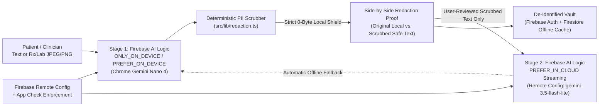

# CliniVault Hybrid

**License:** Apache-2.0 · **Live Demo:** https://clinivault-hybrid-ai.web.app · **Hackathon:** [#BuildHybridAI 2026](https://firebasehybridaihackathon.devpost.com/)

**Privacy-first medical document & lab triage PWA built for [#BuildHybridAI 2026](https://firebasehybridaihackathon.devpost.com/) using Firebase AI Logic Hybrid Inference (Gemini Nano 4 + Cloud Gemini).**

Patient lab reports, discharge instructions, and prescription bottle photos contain sensitive identifiers (names, dates of birth, phone numbers, MRNs, SSNs, home addresses). **CliniVault Hybrid** separates *local privacy redaction* from *de-identified cloud clinical synthesis* inside a two-stage hybrid pipeline:

1. **Stage 1 — Local Privacy Shield (`ONLY_ON_DEVICE` or `PREFER_ON_DEVICE`):** Extracts clinical findings, urgency level, and a fully scrubbed version of the text/image directly on the user's browser via **Chrome Gemini Nano 4** (`firebase/ai` Hybrid SDK + `Schema` structured JSON output), reinforced with a deterministic client-side regex scrubber (`0 B` transmitted to cloud when running on-device).
2. **Stage 2 — Deep Care-Prep Synthesis (`PREFER_IN_CLOUD`):** Streams longitudinal drug/lab interaction notes and Top 5 clinician visit questions strictly from the de-identified summary (controlled dynamically via **Firebase Remote Config**), automatically falling back to on-device execution when offline.

---

## Architecture



---

## Runtime Firebase AI Logic & Firebase Services Inventory

Every required Firebase capability is imported and called directly at runtime:

- **Firebase AI Logic Hybrid Inference (`src/lib/hybridAi.ts`, `src/lib/firebase.ts`):**
  - Uses `getAI(app, { backend: new GoogleAIBackend() })`, `getGenerativeModel`, `InferenceMode.ONLY_ON_DEVICE`, `InferenceMode.PREFER_ON_DEVICE`, `InferenceMode.PREFER_IN_CLOUD`, `InferenceMode.ONLY_IN_CLOUD` (cloud retry path), `onDeviceParams` (`expectedInputs`, `responseConstraint`), `inCloudParams` (`responseSchema`, `responseMimeType`), `initializeDeviceModel`, `generateContent`, `generateContentStream` (with stream stall timeout fallback to `generateContent`), and `result.response.inferenceSource`.
- **Firebase App Check (`src/lib/firebase.ts`):** Initializes `initializeAppCheck` (`ReCaptchaV3Provider` + `FIREBASE_APPCHECK_DEBUG_TOKEN` support for localhost/judging debug tokens).
- **Firebase Remote Config (`src/lib/firebase.ts`, `remote_config.json`):** Fetches live routing policy (`cloud_model_name`, `fast_cloud_model_name`, `default_triage_mode`, `max_cloud_output_tokens`, `enable_cloud_synthesis`).
- **Cloud Firestore (`src/lib/vaultStore.ts`, `firestore.rules`):** Stores strictly de-identified summaries under `/users/{uid}/vaultRecords/{recordId}` with IndexedDB offline persistence (`persistentLocalCache`) and strict ownership/type/size rules.
- **Firebase Authentication (`src/App.tsx`, `src/components/AuthDialog.tsx`):** Guest anonymous access and Email & Password sign-in.
- **Firebase Hosting & PWA (`firebase.json`, `public/manifest.webmanifest`, `public/sw.js`):** Serves the installable offline-capable Progressive Web App.

---

## Setup & Running Locally

### Prerequisites
- Node.js 22+
- Desktop Google Chrome **139+** for on-device Gemini Nano 4 Prompt API inference

### 1. Configure Chrome for On-Device Inference (Optional for Local 0-Byte Shield)
1. Open Chrome and navigate to `chrome://flags/#prompt-api-for-gemini-nano-multimodal-input`.
2. Set it to **Enabled** and relaunch Chrome.
3. Either click **Download Local Model** inside CliniVault Hybrid, or run `await LanguageModel.availability()` and `await LanguageModel.create()` in DevTools Console.

### 2. Install & Run
```bash
cp .env.example .env.local
# Populate .env.local with your Firebase Web App config
npm install
npm run dev
```

### 3. Verify & Deploy
```bash
npx tsc -p tsconfig.json --noEmit
npm run lint
npm run build
npx -y firebase-tools@latest deploy
```

---

## License

Licensed under the **Apache License, Version 2.0**. See [LICENSE](./LICENSE).
